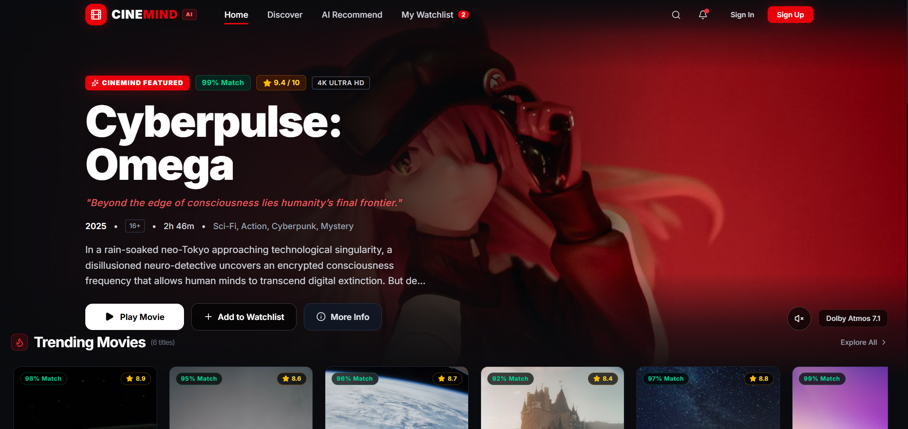
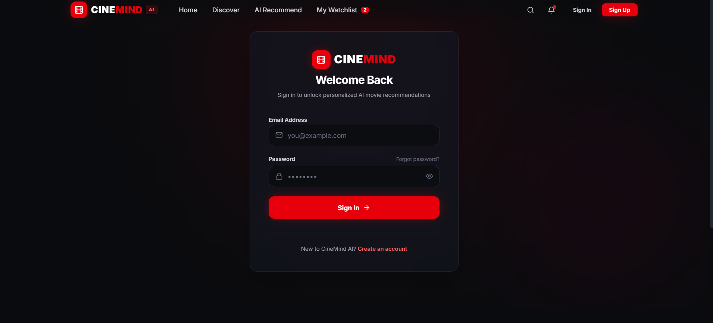

# 🎬 CineMind AI

### AI-Powered Movie Discovery and Streaming Platform

CineMind AI is a full-stack movie platform inspired by modern streaming applications. It helps users discover movies, manage watchlists, get AI-powered recommendations, and enjoy video playback through a cinematic interface.

## ✨ Features

- User Registration and Login
- Secure Authentication using JWT
- Movie Search and Discovery
- AI-Powered Mood-Based Recommendations
- Personal Watchlist
- Movie Details
- Video Player with Playback Controls
- Continue Watching and Progress Tracking
- Admin Dashboard and Movie Management
- Responsive Dark-Themed UI

## 🛠️ Tech Stack

**Frontend**
- React.js
- Vite
- Tailwind CSS
- React Router
- Axios

**Backend**
- Node.js
- Express.js
- MongoDB
- Mongoose
- JWT Authentication
- bcryptjs

## 📁 Project Structure

```text
CineMind-AI/
├── frontend/
│   ├── src/
│   └── package.json
├── backend/
│   ├── config/
│   ├── models/
│   ├── controllers/
│   ├── routes/
│   ├── middleware/
│   └── server.js
└── README.md
```

## 🚀 Getting Started

### 1. Clone the Repository

```bash
git clone https://github.com/Devpatel452/CineMind-AI.git
cd CineMind-AI
```

### 2. Setup Backend

```bash
cd backend
npm install
```

Configure your backend environment variables using `.env.example`, then start:

```bash
npm start
```

### 3. Setup Frontend

Open another terminal:

```bash
cd frontend
npm install
npm run dev
```

## 🌐 Live Demo

[Open CineMind AI](https://cinemind-ai.vercel.app/)

*Replace this URL with your actual Vercel deployment URL if it is different.*

## 👨‍💻 Developer

**Dev Patel**

GitHub: [Devpatel452](https://github.com/Devpatel452)

---

⭐ If you like this project, consider giving it a star!

## 📸 Project Preview





